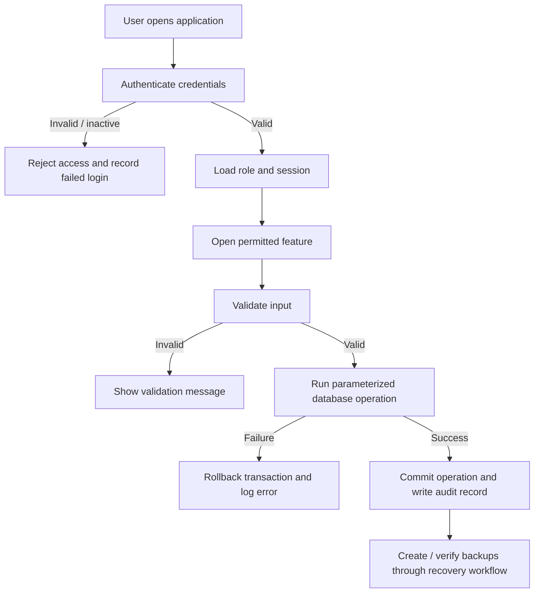

# Stakeholders, Use Cases and Process Workflows

## Stakeholder register

| Stakeholder | Need / concern | System response | Evidence |
|---|---|---|---|
| Administrator | Manage users, access and recovery | User management, role checks, audit logs and backup screen | Live role and backup demonstration |
| HR user | Maintain accurate employee records | Employee create, search, update and deactivate | Employee CRUD test cases |
| Employee account | Prevent unnecessary access to administrative actions | Least-privilege role permissions | Permission tests / live restricted-role demo |
| Project evaluator | Verify functionality and quality controls | SRS, architecture, test results, FMEA and user manual | Documentation and demo |

## As-Is process

Employee details may be held in spreadsheets or manual records. Searching, updating, identifying duplicate information, tracing changes and recovering from accidental loss can be difficult without a common controlled application.

## To-Be process

## Primary use cases

1. **Authenticate user:** valid active account is allowed into the system; invalid credentials are rejected.
2. **Maintain employee:** authorized user creates, searches, updates or deactivates an employee; required data is validated and database constraints prevent duplicates.
3. **Manage users:** administrator creates or updates user accounts and role assignments.
4. **Review audit trail:** authorized administrator searches recorded operations.
5. **Backup and recovery:** authorized administrator creates a backup, validates it and restores a selected valid backup after a safety copy is created.

## Role-permission summary

| Capability | Admin | HR | Employee |
|---|---:|---:|---:|
| View employee records | Yes | Yes | Yes (current role policy; UI capability is limited) |
| Create/update/deactivate employee records | Yes | Yes | No |
| Manage user accounts | Yes | No | No |
| View audit logs | Yes | No | No |
| Manage backups | Yes | No | No |

The role table reflects the implemented permission map. If instructor expectations differ, revise the policy and test it explicitly.
